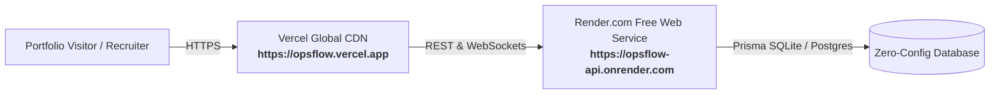

# 🚀 OpsFlow 100% Free Production Deployment Guide

This guide walks you step-by-step through deploying **OpsFlow** for **free** (zero credit card required) so you can share a live working demo on your portfolio, resume, and GitHub.

---

## 🏗️ Deployment Architecture



---

## 📌 Phase 1: Push Your Code to GitHub (2 Minutes)

Open your terminal in the `opsflow` root folder:

```bash
# 1. Initialize Git repository
git init

# 2. Stage and commit all files
git add .
git commit -m "feat: OpsFlow enterprise platform production release"

# 3. Create a new repository on https://github.com/new named 'opsflow'
# 4. Link your remote repository and push (replace with your GitHub username)
git remote add origin https://github.com/YOUR_GITHUB_USERNAME/opsflow.git
git branch -M main
git push -u origin main
```

---

## 📌 Phase 2: Deploy Backend on Render.com (3 Minutes)

1. Go to **[Render.com](https://render.com)** and sign in with GitHub (100% Free).
2. Click **New +** in the top right &rarr; select **Web Service**.
3. Select your `opsflow` repository.
4. Fill in the deployment settings:
   - **Name**: `opsflow-api`
   - **Root Directory**: `backend`
   - **Runtime**: `Node`
   - **Build Command**: 
     ```bash
     npm install && npx prisma generate && npx prisma db push && npx tsx src/database/prisma/seed.ts && npm run build
     ```
   - **Start Command**: 
     ```bash
     npm start
     ```
   - **Instance Type**: Select **Free** ($0 / month).

5. Scroll down to **Environment Variables** and add:

| Key | Value | Notes |
| :--- | :--- | :--- |
| `NODE_ENV` | `production` | Production mode |
| `PORT` | `10000` | Render default port |
| `DATABASE_URL` | `file:./dev.db` | Auto-seeded SQLite database |
| `JWT_SECRET` | `opsflow_prod_super_secret_jwt_key_2026_x99` | Random secret key |
| `JWT_REFRESH_SECRET` | `opsflow_prod_super_refresh_jwt_key_2026_y99` | Random secret key |
| `ADMIN_ALERT_EMAIL` | `mozework11@gmail.com` | Alert receiver |
| `EMAIL_PROVIDER` | `mock` | 100% Free local outbox |

6. Click **Deploy Web Service**.
7. Once deployed (in ~1-2 minutes), Render will display your live Backend URL:
   `https://opsflow-api.onrender.com` (Save this URL!).

---

## 📌 Phase 3: Deploy Frontend on Vercel (2 Minutes)

1. Go to **[Vercel.com](https://vercel.com)** and sign in with GitHub (100% Free).
2. Click **Add New...** &rarr; **Project**.
3. Import your `opsflow` repository.
4. In the configuration screen:
   - **Framework Preset**: `Vite`
   - **Root Directory**: Click **Edit** &rarr; select `frontend` &rarr; click **Continue**.
   - **Build Command**: `npm run build`
   - **Output Directory**: `dist`
5. Open the **Environment Variables** section and add:

| Key | Value |
| :--- | :--- |
| `VITE_API_URL` | `https://opsflow-api.onrender.com/api/v1` *(Your Render backend URL + /api/v1)* |
| `VITE_SOCKET_URL` | `https://opsflow-api.onrender.com` *(Your Render backend URL)* |

6. Click **Deploy**.
7. In ~45 seconds, Vercel will give you a live production link:
   `https://opsflow-app.vercel.app` 🎉

---

## 📌 Phase 4: Test & Verify Your Live Deployment

1. Open your Vercel URL in your browser: `https://opsflow-app.vercel.app`.
2. Log in using the pre-seeded Demo Enterprise credentials:
   - **Email**: `admin@nexuscloud.io`
   - **Password**: `Password123!`
3. Check that the top-right **Real-Time Status Bar** shows `🟢 REAL-TIME ACTIVE`.
4. Create a task or incident &rarr; check that notifications and the War Room update instantly!

---

## 🌟 Quick Links for Your Portfolio / Resume

- **Live Production App**: `https://opsflow-app.vercel.app`
- **Swagger OpenAPI Specs**: `https://opsflow-api.onrender.com/api-docs`
- **Developer Service Portal**: `https://opsflow-api.onrender.com`
- **Whitepaper PDF**: Downloadable from GitHub `OpsFlow_Enterprise_Documentation.pdf`
