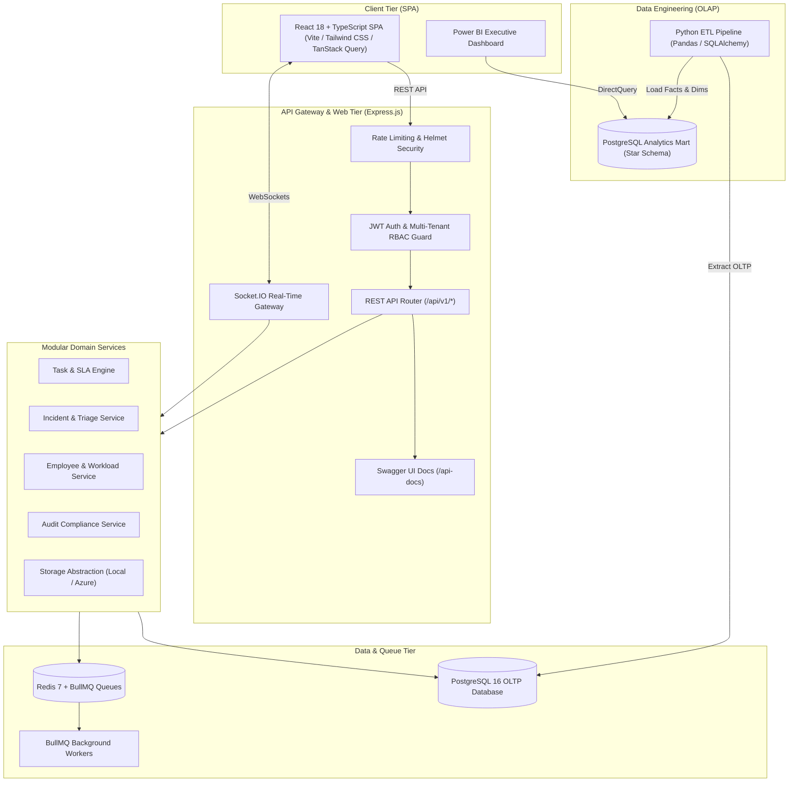

# OpsFlow — Enterprise Operations Management & Analytics Platform

[](https://github.com/opsflow/opsflow/actions)
[](LICENSE)
[](https://nodejs.org)
[](https://react.dev)
[](https://www.typescriptlang.org)
[](https://www.postgresql.org)
[](https://www.docker.com)

**OpsFlow** is a production-quality, multi-tenant enterprise operations platform designed for mid-to-large organizations to coordinate workforce operations, manage SLA-driven tasks, triage critical incidents, track employee capacity, enforce compliance audit trails, and stream real-time operational telemetry into Power BI-ready Star Schema data models.

---

## 1. System Architecture



---

## 2. Core Capabilities & Feature Modules

- **🏢 Multi-Tenant Architecture**: Strict row-level data isolation across multiple organizations enforced at the database and middleware layers.
- **🛡️ Granular RBAC**: Role-Based Access Control (`ADMIN`, `MANAGER`, `EMPLOYEE`, `ANALYST`) with backend authorization.
- **⏱️ Automated SLA Engine**: Dynamic SLA deadline computation based on severity matrices (P1=1h, P2=4h, P3=12h, P4=48h) with active breach alerts.
- **⚡ Real-Time Telemetry**: WebSockets with room segregation per tenant (`org:<id>`), per task (`task:<id>`), and per incident (`incident:<id>`).
- **📊 Executive KPI Dashboard**: Real-time Recharts visualizations showing 7-day velocity trends, severity splits, department allocations, and employee capacity meters.
- **📋 Task & Workflow Management**: Dual Table view and Kanban Board view with instant status transitions, activity timeline, and comments stream.
- **🚨 Incident Triage Command**: Live war room discussion, diagnostic notes, on-call assignment, and MTTR tracking.
- **👥 Workforce & Capacity Management**: Real-time load score calculations (active tasks $\times 10$ + incidents $\times 25$) to prevent team burnout.
- **🔒 Compliance Audit Logging**: Immutable recording of logins, role promotions, status transitions, and data mutations with IP tracking.
- **📈 Data Engineering & Power BI**: Standalone Python ETL pipelines generating Star Schema dimensional models (`fact_tasks`, `fact_incidents`, `dim_employee`).
- **📦 Cloud & DevOps Ready**: Multi-stage Dockerfiles, Docker Compose stack, and GitHub Actions CI/CD workflows.

---

## 3. Technology Stack

| Layer | Technologies |
| :--- | :--- |
| **Frontend** | React 18, TypeScript, Vite, Tailwind CSS, React Router v6, TanStack Query v5, Recharts, Lucide Icons, Axios |
| **Backend** | Node.js, TypeScript, Express.js, Zod, JWT, bcryptjs, Helmet, CORS, Winston, Multer, Swagger UI |
| **Database & ORM** | PostgreSQL 16, Prisma ORM |
| **Queues & Caching**| Redis 7, BullMQ |
| **Real-Time** | Socket.IO |
| **Data Engineering**| Python 3.11, Pandas, SQLAlchemy, PostgreSQL Star Schema |
| **DevOps & Cloud** | Docker, Docker Compose, NGINX, GitHub Actions CI/CD, Azure Architecture |
| **Testing** | Jest, Supertest, Vitest |

---

## 4. Repository Structure

```
opsflow/
├── backend/                  # Express REST API & Real-time Core
│   ├── src/
│   │   ├── config/           # Strongly-typed environment loader (Zod)
│   │   ├── database/         # Prisma schema and realistic enterprise seed script
│   │   ├── middleware/       # Auth, RBAC, tenant isolation, rate limiter, error handler
│   │   ├── modules/          # Domain modules (auth, tasks, incidents, employees, analytics, etc.)
│   │   ├── sockets/          # Socket.IO real-time server
│   │   ├── jobs/             # BullMQ background workers and queues
│   │   ├── app.ts            # Express application factory
│   │   └── server.ts         # Server bootstrap with graceful shutdown
│   └── tests/                # Jest integration test suites
├── frontend/                 # React 18 + Vite SPA
│   ├── src/
│   │   ├── components/       # Enterprise UI kit (Badge, Card, Modal, Button, Table, etc.)
│   │   ├── context/          # Auth, Socket, and Toast context providers
│   │   ├── pages/            # Dashboard, Tasks, Incidents, Employees, Analytics, Audit, etc.
│   │   └── types/            # TypeScript domain interfaces
├── data-engineering/         # Python ETL Pipeline (OLTP -> Star Schema)
│   ├── etl/                  # extract.py, transform.py, load.py, pipeline.py
│   └── models/               # star_schema.sql DDL definitions
├── docs/                     # Full Architectural Documentation
│   ├── architecture.md       # High-level architecture & Mermaid diagrams
│   ├── database.md           # ER diagram & data dictionary
│   ├── api.md                # REST API catalog
│   ├── authentication.md     # JWT & RBAC specifications
│   ├── power-bi-guide.md     # Power BI connection & DAX KPI guide
│   └── deployment.md         # Local & Azure cloud deployment guide
├── docker/                   # Multi-stage production Dockerfiles
├── .github/workflows/        # CI/CD pipeline
└── docker-compose.yml        # Full stack orchestration (Postgres, Redis, App, Worker)
```

---

## 5. Quick Start & Local Setup

### 1. Install Dependencies
```bash
# In the root directory
npm install
cd backend && npm install
cd ../frontend && npm install
```

### 2. Start Infrastructure via Docker
```bash
docker compose up postgres redis -d
```

### 3. Initialize Database & Seed Realistic Enterprise Data
```bash
cd backend
npm run prisma:generate
npm run prisma:push
npm run prisma:seed
```

### 4. Run Development Stack
```bash
# From the root directory:
npm run dev
```
- **Frontend SPA**: `http://localhost:3000`
- **Backend API**: `http://localhost:5000`
- **Swagger Documentation**: `http://localhost:5000/api-docs`

---

## 6. Demo Accounts (Seeded)

| Role | Email | Password | Permissions |
| :--- | :--- | :--- | :--- |
| **Admin** | `admin@nexuscloud.io` | `Password123!` | Full tenant control, IAM, audit logs, analytics |
| **Manager** | `sarah.connor@nexuscloud.io` | `Password123!` | Workload allocation, incident triage, team analytics |
| **Employee** | `marcus.vance@nexuscloud.io` | `Password123!` | Assigned tasks, incident reporting, status updates |

*(The login screen also features 1-click demo login buttons for seamless review!)*

---

## 7. Running the Python ETL Pipeline

```bash
cd data-engineering
python3 -m venv venv
source venv/bin/activate
pip install -r requirements.txt
python etl/pipeline.py
```

---

## 8. Automated Testing & Verification

```bash
# Run backend Jest tests
npm run test --workspace=backend

# Run frontend typechecking & linting
npm run lint --workspace=frontend
```

---

## 9. License

OpsFlow is open-sourced under the MIT License.
