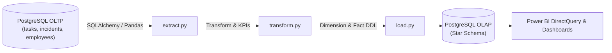

# OpsFlow Data Engineering & ETL Architecture

## 1. Overview

The `data-engineering` subsystem provides a Python-based ETL pipeline (Extract-Transform-Load) designed to convert high-frequency transactional data (OLTP) from the OpsFlow PostgreSQL database into an analytical Star Schema (OLAP) optimized for Power BI, Tableau, and executive dashboards.



## 2. Dimensional Data Model

- **`dim_organization`**: Organization hierarchy, plan tier, industry classification.
- **`dim_department`**: Department taxonomy and code mappings.
- **`dim_employee`**: Employee profile, designations, skills.
- **`dim_date`**: Calendar date dimension (year, quarter, month, day of week, weekend flags).
- **`fact_tasks`**: Cycle time, SLA breach indicator, variance hours between estimate and actuals.
- **`fact_incidents`**: Incident severity, MTTR (Mean Time to Resolution), SLA variance.
- **`fact_employee_daily_workload`**: Daily aggregated employee workload score.

## 3. How to Run the ETL Pipeline

```bash
cd data-engineering
python3 -m venv venv
source venv/bin/activate
pip install -r requirements.txt
python etl/pipeline.py
```
