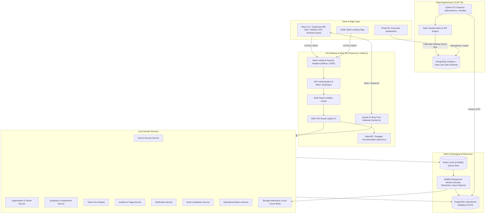
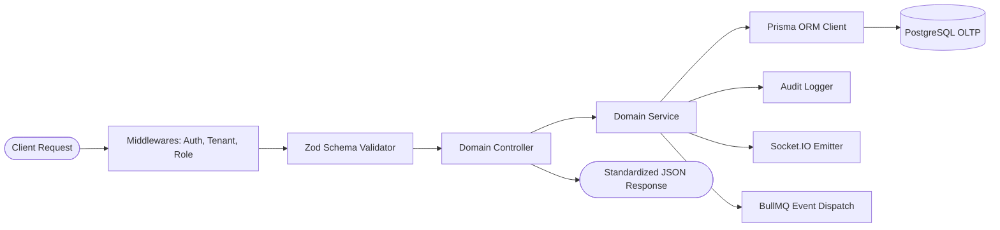

# OpsFlow Architecture Documentation

## 1. Executive Summary

**OpsFlow** is an enterprise-grade multi-tenant Operations Management & Analytics SaaS platform designed for medium and large organizations. It provides centralized management for employees, departments, SLA-driven tasks, critical operational incidents, real-time alerting, audit compliance, automated background processing, and analytical data modeling ready for Power BI/BI dashboards.

---

## 2. High-Level System Architecture

---

## 3. Modular Domain Architecture

OpsFlow strictly enforces separation of concerns across layers:
`HTTP Request` $\rightarrow$ `Middleware (RateLimit, Auth, Tenant)` $\rightarrow$ `Validation (Zod)` $\rightarrow$ `Controller` $\rightarrow$ `Service Layer` $\rightarrow$ `Prisma Database Client` $\rightarrow$ `Audit/Socket/Job Side-Effects` $\rightarrow$ `Normalized Standard Response`.

---

## 4. Multi-Tenancy & Data Isolation Model

Every domain entity in OpsFlow belongs to an `organizationId`. Multi-tenancy is enforced strictly at the database access and middleware layers:
1. **Tenant Extraction**: Authentication token decrypts user identity including active `organizationId` and role.
2. **Context Propagation**: Request scoped context injects tenant parameters into service methods.
3. **Query Scoping**: All Prisma queries explicitly filter by `organizationId`. A tenant can never read, update, or delete records from another tenant.
4. **Foreign Key Integrity**: All relational constraints (`Department`, `Employee`, `Task`, `Incident`, `AuditLog`) maintain referential integrity with the root `Organization`.

---

## 5. Role-Based Access Control (RBAC) Matrix

| Permission / Capability | ADMIN | MANAGER | EMPLOYEE |
| :--- | :---: | :---: | :---: |
| **Manage Organization Settings** | ✅ | ❌ | ❌ |
| **Manage Users & Role Assignment** | ✅ | ❌ | ❌ |
| **Manage Departments & Organization Roster** | ✅ | ❌ | ❌ |
| **View All Tasks across Organization** | ✅ | ✅ | ❌ (Assigned/Created only) |
| **Create & Assign Tasks** | ✅ | ✅ | ❌ (Request/Create within dept) |
| **Change Task Status / Log Work** | ✅ | ✅ | ✅ (Assigned tasks) |
| **View All Incidents & Triage** | ✅ | ✅ | ❌ (Reported only) |
| **Create Incidents & Breaches** | ✅ | ✅ | ✅ |
| **Resolve / Close Incidents** | ✅ | ✅ | ❌ |
| **Access Executive Analytics & KPIs** | ✅ | ✅ (Team/Dept) | ❌ (Own performance) |
| **View System Audit Logs** | ✅ | ❌ | ❌ |
| **Export ETL / Analytics Datasets** | ✅ | ❌ | ❌ |

---

## 6. Real-Time & Event Architecture

OpsFlow uses **Socket.IO** with authenticated rooms:
- Room `org:<organizationId>`: Organization-wide real-time broadcasts (e.g. critical incident reported).
- Room `user:<userId>`: Private real-time notifications (e.g. task assigned, SLA warning).
- Room `task:<taskId>`: Real-time collaborative comments and live status changes.
- Room `incident:<incidentId>`: Incident triage room for response teams.

---

## 7. Background Processing & Queuing

**BullMQ** backed by **Redis** handles decoupled asynchronous workloads:
1. **`emailQueue`**: Welcome emails, password reset tokens, SLA breach notices, assignment pings.
2. **`notificationQueue`**: Push notifications and in-app alerts generation.
3. **`slaMonitorQueue`**: Periodic cron (every 60 seconds) scanning open tasks and incidents for approaching SLAs and breach status.
4. **`reportQueue`**: Heavy operational report exports and CSV generation.

---

## 8. Data Engineering & OLAP Star Schema

The Python ETL pipeline periodically extracts transactional records from PostgreSQL OLTP, transforms metrics into fact and dimension tables, and populates analytics-optimized tables:
- **`dim_organization`**, **`dim_department`**, **`dim_employee`**, **`dim_date`**, **`dim_priority`**, **`dim_status`**
- **`fact_tasks`**: Granular task durations, estimated vs actual hours, turnaround time, SLA flag.
- **`fact_incidents`**: Time to acknowledge (TTA), time to resolve (TTR), SLA breach duration.
- **`fact_employee_daily_workload`**: Aggregated workload, active task count, completion velocity.
- **`fact_audit_events`**: Security telemetry and operational changes.
