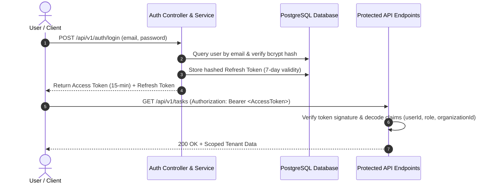

# Authentication & Multi-Tenant RBAC Security

## 1. Authentication Architecture

OpsFlow implements a secure stateless JWT (JSON Web Token) authentication architecture paired with persistent database-backed Refresh Token rotation.

## 2. Refresh Token Rotation

When the 15-minute access token expires:
1. Axios interceptor intercepts the `401 Unauthorized` response.
2. Sends `POST /api/v1/auth/refresh` with the stored refresh token.
3. The server validates token expiration, revokes the old refresh token, and issues a new pair.
4. The client automatically replays the original API request.

## 3. RBAC Capabilities

- **`ADMIN`**: Complete tenant ownership, organization branding, user management, audit logs, and global analytics.
- **`MANAGER`**: Team workload allocation, task creation, incident triage, and department telemetry.
- **`EMPLOYEE`**: Access to assigned work items, incident reporting, status transitions, and personal performance scorecards.
- **`ANALYST`**: Read-only access to analytics dashboards and Power BI exports.
