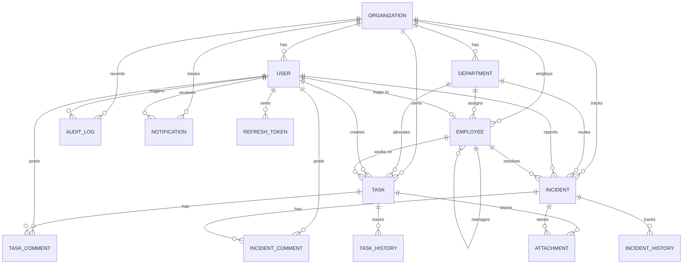

# Database Architecture & Schema Documentation

## 1. Overview

OpsFlow leverages **PostgreSQL** as its transactional operational store (OLTP). The schema is fully normalized, enforces referential integrity through foreign keys, provides row-level tenant isolation with `organizationId`, and indexes high-throughput query dimensions.

---

## 2. Entity-Relationship Diagram

---

## 3. Data Dictionary

### 3.1 `organizations`
- `id` (UUID, PK)
- `name` (VARCHAR, Organization legal/brand name)
- `slug` (VARCHAR, Unique tenant identifier e.g., `acme-corp`)
- `domain` (VARCHAR, SSO domain binding)
- `plan` (VARCHAR, e.g., `ENTERPRISE`, `PRO`)
- `isActive` (BOOLEAN, Tenant account active status)
- `settings` (JSONB, Theme, SLA default preferences, working hours)

### 3.2 `users`
- `id` (UUID, PK)
- `organizationId` (UUID, FK $\rightarrow$ `organizations.id`)
- `email` (VARCHAR, Unique user login email)
- `passwordHash` (VARCHAR, Argon2 / Bcrypt salted hash)
- `firstName`, `lastName` (VARCHAR)
- `role` (ENUM: `ADMIN`, `MANAGER`, `EMPLOYEE`, `ANALYST`)
- `status` (ENUM: `ACTIVE`, `INACTIVE`, `SUSPENDED`)
- `lastLoginAt` (TIMESTAMP)

### 3.3 `employees`
- `id` (UUID, PK)
- `organizationId` (UUID, FK $\rightarrow$ `organizations.id`)
- `userId` (UUID, Nullable FK $\rightarrow$ `users.id`)
- `departmentId` (UUID, FK $\rightarrow$ `departments.id`)
- `managerId` (UUID, Self-referential FK $\rightarrow$ `employees.id`)
- `employeeCode` (VARCHAR, Unique per org e.g. `EMP-001`)
- `designation` (VARCHAR, e.g., "Senior Infrastructure Engineer")
- `skills` (TEXT Array, e.g. `["Kubernetes", "PostgreSQL", "Node.js"]`)
- `status` (ENUM: `ACTIVE`, `ON_LEAVE`, `TERMINATED`)

### 3.4 `tasks`
- `id` (UUID, PK)
- `taskCode` (VARCHAR, e.g. `TSK-1042`)
- `organizationId` (UUID, FK $\rightarrow$ `organizations.id`)
- `departmentId` (UUID, FK $\rightarrow$ `departments.id`)
- `assignedToId` (UUID, FK $\rightarrow$ `employees.id`)
- `createdById` (UUID, FK $\rightarrow$ `users.id`)
- `title`, `description` (TEXT)
- `priority` (ENUM: `LOW`, `MEDIUM`, `HIGH`, `CRITICAL`)
- `status` (ENUM: `BACKLOG`, `ASSIGNED`, `IN_PROGRESS`, `IN_REVIEW`, `COMPLETED`, `CANCELLED`)
- `estimatedHours`, `actualHours` (FLOAT)
- `startDate`, `dueDate`, `completedDate` (TIMESTAMP)
- `slaHours` (FLOAT, default 24h)
- `slaDeadline` (TIMESTAMP)
- `isSlaBreached` (BOOLEAN)
- `tags` (TEXT Array)

### 3.5 `incidents`
- `id` (UUID, PK)
- `incidentCode` (VARCHAR, e.g. `INC-502`)
- `organizationId` (UUID, FK $\rightarrow$ `organizations.id`)
- `departmentId` (UUID, FK $\rightarrow$ `departments.id`)
- `reportedById` (UUID, FK $\rightarrow$ `users.id`)
- `assignedEmployeeId` (UUID, FK $\rightarrow$ `employees.id`)
- `title`, `description` (TEXT)
- `severity` (ENUM: `LOW`, `MEDIUM`, `HIGH`, `CRITICAL`)
- `status` (ENUM: `OPEN`, `ASSIGNED`, `INVESTIGATING`, `RESOLVED`, `CLOSED`)
- `slaHours` (FLOAT, e.g. P1=1h, P2=4h, P3=12h, P4=48h)
- `slaDeadline` (TIMESTAMP)
- `isSlaBreached` (BOOLEAN)
- `resolvedAt`, `closedAt` (TIMESTAMP)
- `resolutionNotes` (TEXT)

### 3.6 `audit_logs`
- `id` (UUID, PK)
- `organizationId` (UUID, FK $\rightarrow$ `organizations.id`)
- `userId` (UUID, FK $\rightarrow$ `users.id`)
- `userEmail` (VARCHAR)
- `action` (VARCHAR, e.g. `TASK_STATUS_CHANGED`, `INCIDENT_RESOLVED`)
- `entity` (VARCHAR, `Task`, `Incident`, `Employee`, `User`)
- `entityId` (VARCHAR)
- `oldValues` (JSONB)
- `newValues` (JSONB)
- `ipAddress` (VARCHAR)
- `userAgent` (VARCHAR)
- `createdAt` (TIMESTAMP)

---

## 4. Performance & Indexing Strategy

1. **Multi-Tenant Indexing**: Every table includes an index on `organizationId` or compound `(organizationId, code/status)`.
2. **Filter Optimization**: `tasks(status, priority, dueDate)` and `incidents(status, severity)` have B-Tree indexes for instantaneous dashboard aggregation and filtering.
3. **Audit History Tracking**: `audit_logs(organizationId, createdAt DESC)` supports high-speed compliance querying and pagination.
