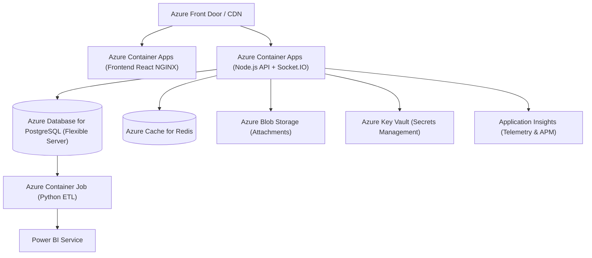

# OpsFlow Deployment & Cloud Guide

## 1. Local Development Setup

### Prerequisites
- Node.js $\ge$ 20.x
- Docker & Docker Compose
- Python $\ge$ 3.10 (for Data Engineering ETL)

### Quick Start
```bash
# 1. Clone repository & install dependencies
npm install

# 2. Start PostgreSQL and Redis
docker compose up postgres redis -d

# 3. Setup environment variables
cp .env.example .env
cp backend/.env.example backend/.env

# 4. Run Prisma database migrations and seed data
cd backend
npm run prisma:generate
npm run prisma:push
npm run prisma:seed
cd ..

# 5. Start development servers (Backend :5000 + Frontend :3000)
npm run dev
```

---

## 2. Docker Container Deployment

To launch the full containerized stack locally:
```bash
docker compose up --build -d
```
- **Frontend SPA**: `http://localhost:3000`
- **Backend API**: `http://localhost:5000`
- **Swagger UI**: `http://localhost:5000/api-docs`
- **PostgreSQL**: `localhost:5432`
- **Redis**: `localhost:6379`

---

## 3. Azure Cloud Architecture Guide

OpsFlow is designed for enterprise Azure deployment:


