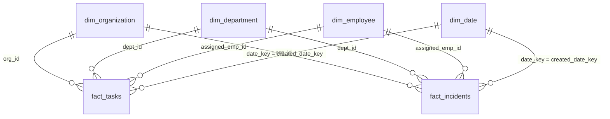

# OpsFlow Power BI Integration & Analytics Guide

## 1. Connecting Power BI to OpsFlow Analytics

1. Open **Power BI Desktop**.
2. Click **Get Data** $\rightarrow$ **PostgreSQL database**.
3. **Server**: `localhost:5432` (or your Azure PostgreSQL host).
4. **Database**: `opsflow_analytics` (or `opsflow_db`).
5. **Data Connectivity mode**: Select **DirectQuery** (for live telemetry) or **Import** (for high performance in-memory caching).
6. Enter credentials: Username `opsflow_admin`, Password `opsflow_secure_password_2026`.
7. Select tables:
   - `dim_organization`
   - `dim_department`
   - `dim_employee`
   - `dim_date`
   - `fact_tasks`
   - `fact_incidents`
   - `fact_employee_daily_workload`

---

## 2. Power BI Relationship Diagram (Star Schema)

Ensure the following 1-to-many ($1 \rightarrow *$) relationships are active in the Power BI Model View:



---

## 3. Core DAX KPI Measures

### 3.1 Task Completion Rate
```dax
Task Completion Rate = 
DIVIDE(
    CALCULATE(COUNTROWS(fact_tasks), fact_tasks[status] = "COMPLETED"),
    COUNTROWS(fact_tasks),
    0
)
```

### 3.2 SLA Compliance Percentage
```dax
SLA Compliance Rate = 
VAR TotalResolved = CALCULATE(COUNTROWS(fact_incidents), fact_incidents[status] IN {"RESOLVED", "CLOSED"})
VAR SlaMet = CALCULATE(COUNTROWS(fact_incidents), fact_incidents[status] IN {"RESOLVED", "CLOSED"}, fact_incidents[is_sla_breached] = FALSE())
RETURN
DIVIDE(SlaMet, TotalResolved, 1.0) * 100
```

### 3.3 Average Resolution Time (MTTR in Hours)
```dax
MTTR (Hours) = 
AVERAGE(fact_incidents[resolution_time_hours])
```

### 3.4 Overdue Tasks Count
```dax
Overdue Tasks = 
CALCULATE(
    COUNTROWS(fact_tasks),
    fact_tasks[is_overdue] = TRUE()
)
```

---

## 4. Recommended Power BI Report Pages

1. **Executive Overview Page**: High-level KPI cards, SLA compliance gauge, 30-day task completion velocity, critical incident breakdown.
2. **Operations & SLA Performance Page**: SLA breach trends by department, severity matrix, MTTR distribution by engineer.
3. **Workload & Team Capacity Page**: Active workload by employee, capacity thresholds (Low, Optimal, High, Overloaded), estimated vs actual hours variance.
